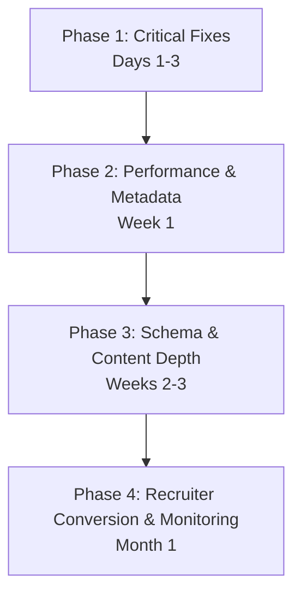

# SEO Implementation Action Plan: aritro.cloud

**Audit Date:** October 28, 2026  
**Domain:** `https://www.aritro.cloud`

---

## Prioritized Implementation Roadmap

---

### Phase 1: Critical & High-Priority Fixes (Days 1 – 3)

| Priority | Task | File / Component | Effort | Expected Impact |
|---|---|---|---|---|
| **P0** | **Clean XML Sitemap:** Remove `/llms.txt`, `/llms-full.txt`, and `/ai.txt` from `<urlset>` | `public/sitemap.xml` | 5 mins | Eliminates Google Search Console sitemap indexing errors |
| **P0** | **Consolidate Profile Slugs:** Configure a 301 redirect from `/aritro-saha` to `/aritrosaha` in `vercel.json` | `vercel.json` | 10 mins | Eliminates keyword cannibalization and resolves thin content flags on branded search |
| **P1** | **Homepage Fallback Internal Linking:** Add navigation links to `/about`, `/gallery`, and `/aritrosaha` inside the pre-rendered `#root` article | `index.html` & `scripts/prerender-routes.js` | 20 mins | Passes crawl equity and PageRank directly from homepage root to all top-level sections |
| **P1** | **Pre-Render Gallery Images:** Inject all 8 gallery images with `<figure>`, ``, and captions into `dist/gallery/index.html` | `scripts/prerender-routes.js` | 30 mins | Enables Google Image Search indexing for gallery photos from raw static HTML |

---

### Phase 2: Performance & Metadata Quick Wins (Week 1)

| Priority | Task | File / Component | Effort | Expected Impact |
|---|---|---|---|---|
| **P1** | **Compress Favicon:** Re-generate `favicon.ico` using 16x16 and 32x32 PNG compression (< 20 KB) + add SVG vector icon | `public/favicon.ico` & `index.html` | 20 mins | Saves ~265 KB transfer on every first-time visitor's critical path |
| **P2** | **Add Open Graph Site Name & Locale:** Add `og:site_name="Aritro Saha Portfolio"` and `og:locale="en_US"` | `index.html` & `scripts/prerender-routes.js` | 5 mins | Improves Google Site Name recognition in mobile SERP snippets |
| **P2** | **Synchronize `.well-known/ai.txt`:** Overwrite `.well-known/ai.txt` with the v1.1.1 spec from `public/ai.txt` | `public/.well-known/ai.txt` | 5 mins | Ensures consistent crawler policy regardless of which standard endpoint AI bots query |
| **P2** | **Hero LCP Image Prioritization:** Add `fetchpriority="high"` to primary headshot `` | `index.html` & `src/components/Header.jsx` | 5 mins | Accelerates Largest Contentful Paint (LCP) score |

---

### Phase 3: Schema & Content Depth (Weeks 2 – 3)

| Priority | Task | File / Component | Effort | Expected Impact |
|---|---|---|---|---|
| **P2** | **Arcade Schema Markup:** Add `VideoGame` and `WebApplication` Schema.org JSON-LD to `/play/*` routes | `scripts/prerender-routes.js` | 45 mins | Unlocks interactive rich snippet potential for browser mini-games |
| **P2** | **Expand Arcade Static Text:** Add 200+ words of instructions, rules, and architecture notes to each game fallback | `scripts/prerender-routes.js` | 1 hour | Eliminates thin-content perception on game pages for search crawlers |
| **P3** | **ScholarlyArticle Schema:** Add `ScholarlyArticle` schema to `/projects/glide-connect` referencing IJIRT paper | `scripts/prerender-routes.js` | 15 mins | Enhances academic grounding in Google Scholar and AI answer engines |
| **P3** | **Declare Content-Signal:** Add `Content-Signal: search=yes, ai-input=yes, ai-train=yes` to `robots.txt` | `public/robots.txt` | 5 mins | Complies with emerging Cloudflare / IETF agent policy standards |

---

### Phase 4: Recruiter Conversion & Monitoring (Month 1)

| Priority | Task | File / Component | Effort | Expected Impact |
|---|---|---|---|---|
| **P2** | **Dedicated HTML Resume Route:** Build an accessible, indexable `/resume` route with structured `WorkExperience` and PDF download | `src/pages/ResumePage.jsx` | 2 hours | Ranks directly on Google for `"Aritro Saha resume"` searches |
| **P3** | **Submit Sitemaps & Monitor Search Console:** Submit the cleaned `sitemap.xml` to GSC, inspect indexed URLs, and monitor Impressions/CTR | Google Search Console & Bing Webmaster | Ongoing | Tracks indexation velocity and organic impressions |
| **P3** | **Ping IndexNow on Updates:** Keep running `scripts/ping-indexnow.js` on every deployment | `scripts/ping-indexnow.js` | Automated | Instant indexing on Bing, Yandex, and Naver |
